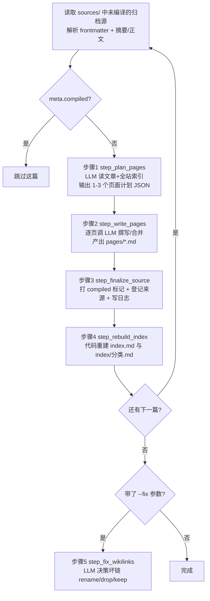
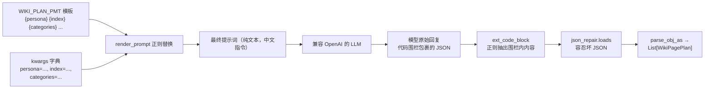
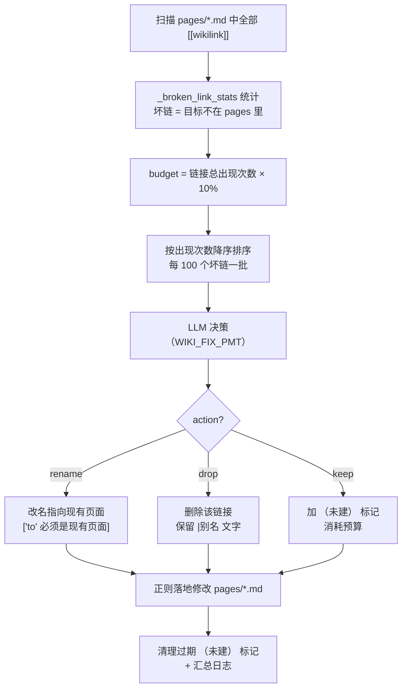
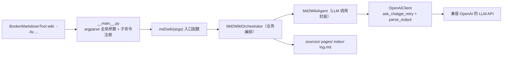

# `wiki` 子命令深度解析：提示词与工作流

> 配套代码：`BookerMarkdownTool/md2wiki*.py`（编排器 / 智能体 / 提示词 / 模型）

## 一、这个命令是干什么的（大白话开篇）

先花 30 秒说清楚"这个东西到底解决什么问题"。

假设你是一位技术社区的知识库维护者，手头有几千篇网页抓下来的归档文章（Markdown）。你想做一件很朴素的事：**把这些零散的文章"沉淀"成一本互相引用、可以按主题跳转的 Wiki 博客观（类似 Obsidian 的双链笔记）**。比如一篇讲"提示词注入攻击"的文章，应该有一个独立的 `prompt-injection.md` 页面，它里面提到提示词泄漏时能 `[[prompt-injection]]` 链到专门的页面；而读 `agent-engineering` 这个分类索引时，又应该能把这篇文章沉淀的页面列出来。

如果全靠人做，几千篇文章得吐。如果全靠代码做，写"知识页面"本质上是阅读理解 + 改写，正则做不到。所以这个子命令选择了**人机分工**：

- **LLM（大模型）只干两件事**：规划（读文章，决定建/改哪些页面，输出 JSON）+ 撰写（逐页写出带 frontmatter 的 Markdown 正文）。
- **代码干所有"确定性"的事**：文件复制、frontmatter 规范化、来源登记、索引重建、坏链统计、日志追加。

代码里第一段 docstring 就把这个哲学写了：

```python
"""Wiki 编译器：把归档源码沉淀为交叉链接的知识百科。

LLM 只做两件事：规划要动哪些页面（JSON）、逐页撰写/合并（Markdown）。
索引与日志由代码维护，确保永不漂移。
"""
```

关键就四个字：**永不漂移（never drift）**。LLM 的输出天生不稳定，你今天让"它"给你生成目录，明天它心情不好就换个格式；所以凡是需要稳定、可被程序消费的东西（索引、符合冲突的 frontmatter、日志），一律不让模型碰，全部由代码确定性重建。这是整个子命令最重要的设计思想。

## 二、目录布局

一个 `wiki` 目录里面有五样东西，各自的职责清清楚楚：

```
wiki_dir/
├── sources/YYYY/MM/*.md   归档原文（不可变的原始快照，按年月存放）
├── pages/*.md             沉淀出来的知识页面，以 [[wikilink]] 互相链接
├── index.md               全站页面目录，每次编译后由代码确定性重建
├── index/<category>.md    每个分类的目录切片（与 index.md 呼应）
└── log.md                 追加式摄取日志（只增不减）
```

对应代码里定义目录的地方：

```python
self.wiki_dir  = Path(self.args.wiki_dir)      # 命令行第一个必填参数
self.src_dir   = self.wiki_dir / "sources"     # 归档区
self.pages_dir = self.wiki_dir / "pages"       # 成品区
```

`pages/*.md` 是唯一"模型写的、会长期存在"的文件；`sources/*.md` 只是模型的**输入快照**，编译后会被打上 `compiled: true` 标记，下次再也不碰。

## 三、总体工作流（一张图看懂）

整个流程分成 5 步（其中第 5 步是可选的坏链修复）：



对应 `run()` 主流程的循环（逐篇处理、逐篇重建索引）：

```python
for i, src in enumerate(pending, 1):
    self._current_src = src
    meta, body = _parse_front(src.read_text(encoding='utf8'))
    summary, content = _split_source_body(body)
    try:
        plan    = self.step_plan_pages(meta, summary, content)   # 步骤 1
        touched = self.step_write_pages(meta, plan, summary, content)  # 步骤 2
        self.step_finalize_source(src, meta, body, touched)      # 步骤 3
        logger.info(f'[wiki {i}/{len(pending)}] {src.name}: {touched or "skip"}')
    except Exception as e:
        logger.warn(f'[wiki {i}/{len(pending)}] {src.name} 失败: {e}')  # 单篇失败不炸全局
    self.step_rebuild_index()                                    # 步骤 4

if getattr(self.args, 'fix', False):
    self.step_fix_wikilinks()                                    # 步骤 5（可选）
```

注意 `try/except`：**单篇文章失败了只记个 warning，继续下一篇**。几千篇的批量任务里，不允许一篇坏数据卡死整个队列。

## 四、提示词设计（`md2wiki_pmt.py`）

提示词全部是全局多行字符串常量，统一叫 `WIKI_XXX_PMT`，用 `{...}` 占位符填充，中文撰写、几乎不做字符串拼接。文件里一共有 **3 个工作提示词 + 1 个人设**。

### 4.1 人设先行：`WIKI_PERSONA`

```python
WIKI_PERSONA = '''
你是一位资深的数字知识库策展人，擅长把零散的文章沉淀为交叉引用、互相关联的结构化知识页面。
'''
```

人设很短，但它是每个工作提示词的开头。它给模型一个"职业身份"：你不是个通用聊天机器人，而是**知识库策展人**，你的产出要交叉引用、互相关联。这比在每次任务里重复叮嘱"你要怎么做人"高效得多，也更稳定——同一个身份出现在所有提示词里，模型输出的口吻和判断标准就比较一致。

### 4.2 规划提示词：`WIKI_PLAN_PMT`

这一步负责回答一个问题：**"读了我给的文章，这个知识库里应该有哪些页面？哪些新建、哪些更新？"**

````python
WIKI_PLAN_PMT = '''
{persona}
## 任务

给定一篇归档文章（含摘要和正文），请规划要创建或更新哪些知识页面。每个页面对应一个独立的主题，页面之间通过 `[[wikilink]]` 互相引用，形成可导航的知识网络。

## 当前索引

```
{index}
```

## 可用的分类

{categories}

## 要求

1.  依据文章内容规划 1 到 3 个页面；只规划文章真正值得沉淀的主题，凡已存在索引中的内容优先归入已有页面。
2.  每个页面的 `file` 字段：以 `.md` 结尾，只写纯文件名，不得包含目录分隔符 `/`。
3.  `action`：目标页面不存在则写 `create`，存在则写 `update`（合并新增观点）。
4.  `category`：只从可用的分类中选取，若无法归入则留空字符串。
5.  `tags`：给出 0 到 5 个小写标签，便于分类聚合同类页面。
6.  输出严格 JSON 格式，用三个反引号（```）包裹。

## 输出格式

```
[
  { "file": "xxx.md", "action": "create", "focus": "一句话概括本页主题", "category": "分类", "tags": ["标签1", "标签2"] },
  ...
]
```

## 待编译文章

标题：{title}
来源：{source}
链接：{url}

### 摘要

{summary}

### 正文

{content}
'''
````

注意几个刻意的设计：

1. **把全站索引喂给模型**（`{index}`）。"凡已存在索引中的内容优先归入已有页面"——这句话只有当模型真的看到了现有索引才能执行。否则每篇文章都往旧页面里写重复内容，知识库会越来越乱。
2. **严格约束文件名**。`file` 必须以 `.md` 结尾、不得含 `/`，这是**安全边界**：防止模型输出 `../evil.md` 之类的东西逃逸 `pages/` 目录去覆盖别的文件。编排器里还有第二道防线（见第七节）。
3. **JSON 用三个反引号（```` ``` ````）包裹**。这是 AGENTS.md 里的项目约定：**输出 JSON 就强调用三个反引号包裹，输出其他内容就用 `[content]...[/content]` 包裹**。目的是让解析端（`ext_code_block` / `ext_cont_block`）能用正则精准切出模型回复里的"有效载荷"，把模型的废话（"好的，我来帮你..."）统统丢掉。
4. 输出格式预先定义好——**Few-shot，教模型长什么样**。只给一个例子就够，因为字段都是简单标量。

### 4.3 撰写提示词：`WIKI_PAGE_PMT`

规划完了，就该真的要写页面了。这一步接的是规划的产物（`file`、`focus`、`category`），要求模型输出一整页带 YAML frontmatter 的 Markdown：

```python
WIKI_PAGE_PMT = '''
{persona}
## 任务

根据归档文章和已有页面，写一份知识页面。页面正文用 Markdown，并在开头附带 YAML frontmatter（用 `---` 包裹）。

## 页面信息

- 文件名：`{file}`
- 关注主题：{focus}
- 所属分类：{category}

## 同类页面（用于互引上下文）

{index}

## 已有内容（`update` 时在此之上合并，`create` 时不复用）

{existing}

## 要求

1.  页面围绕主题组织，观点要准确、忠实原文，不虚构。
2.  正文中的标题用 `##`/`###` 层级，不要在标题前手写编号（系统会自动编号）。
3.  与其他主题交互处用 `[[wikilink]]` 建立交叉引用，但要指向确实存在的页面名。
4.  frontmatter 至少包含 `title`、`description`、`category`、`tags`、`date` 字段；`category` 只能取可用分类或空。
5.  不要写「来源」标题段，来源登记由系统自动维护。
6.  输出用 `[content]...[/content]` 包裹整个页面（含 frontmatter），不要使用代码块围栏。

## 归档文章

标题：{title}
链接：{url}
日期：{date}

### 摘要

{summary}

### 正文

{content}
'''
```

这里有几个值得掰开讲的设计点：

- **`{existing}` 占位符是可选的**。`update` 时把旧页面内容喂进去让模型"在此基础上合并"，`create` 时喂的是 `(新页面,尚无内容)`，起的是占位/防模型幻觉的作用。注意它跟规划提示词一样，**也把上下文喂给了模型**——模型需要知道这个页面以前长什么样，才能"合并新增观点"而不是重写。
- **`{index}` 是"同类页面"**。注意，页面撰写这一步喂的索引不是全站索引，而是 `_category_index(category)`——**同一个分类下的其他页面清单**。这是为了让模型在写交叉引用时有真实可靠的靶子，而不是凭空编 `[[xxx]]`。
- **"不要写来源标题段"**。来源登记（`## 来源` 段）是代码侧维护的（见 7.4），模型写的来源格式不可控，干脆明令禁止。
- **输出用 `[content]...[/content]`**。因为这次输出是"整页 Markdown"，里面天然可能包含代码围栏（正文里贴代码），所以**不能用三个反引号包裹**（否则嵌套围栏会发生解析歧义）；项目约定改用自定义的 `[content]` 标签。

### 4.4 坏链修复提示词：`WIKI_FIX_PMT`

知识库维护久了必然出现**坏链**：某处写了 `[[foo]]`，但 `foo.md` 根本不存在（可能当时笔误、可能页面改名了、可能压根没建）。这个提示词让模型对每个坏链目标做三选一决策：

````python
WIKI_FIX_PMT = '''
{persona}
## 任务

知识库中出现了多个指向不存在页面的坏链 `[[target]]`。请为每个坏链目标决定处理方式：改名为近似页面、删除该链接、或保留（标记为待建）。

## 现有页面

{pages}

## 坏链清单（含出现次数与所在页面）

{broken}

## 全库链接总量

{total}（坏链 {broken_count}）

## 要求

1.  优先 `rename` 到名字最近似的现有页面；若不合适则 `drop` 彻底删除，并兼顾链接中的别名显示。
2.  只有确实值得以后新建的目标才 `keep`，`keep` 的数量受预算限制（约 {budget} 个目标）。
3.  输出严格 JSON 数组，用三个反引号（```）包裹；`to` 字段仅在 `rename` 时填写，且必须是现有页面。

## 输出格式

```
[
  { "target": "坏链目标", "action": "rename", "to": "现有页面" },
  { "target": "坏链目标", "action": "drop" },
  { "target": "坏链目标", "action": "keep" }
]
```
'''
````

两个匠心设计：

- **`{broken}` 带着"出现次数与所在页面"喂给模型**。决策的优先级是:能改名就改名（`rename`）> 不合适就删（`drop`）> 实在值得留才保留。让模型知道"这个坏链出现了 30 次、散落在 12 个页面里"，它才会认真对待；如果整个知识库只出现一次，`drop` 更划算。
- **`keep` 有预算约束 `{budget}`**。`keep` 意味着"以后要建这个页面"——但如果一个 `--fix` 把所有坏链都 `keep`，那知识库会永远挂着一堆"待建"占位，等于没修。所以保持代码侧算好配额：`budget = 全库链接总出现次数 × 10%`，只允许保留约一成的坏链。**这又是一个"模型决策、代码设边界"的例子**。

### 4.5 提示词设计的几条可复用的原则

把三个提示词放在一起看，能总结出这个项目做提示词工程的口诀：

| 原则 | 具体做法 |
| --- | --- |
| 人设统一 | 每个工作提示词都从 `{persona}` 开头 |
| 上下文给够 | 规划时给全站索引，撰写时给同类页面 + 已有内容，修复时给坏链统计 |
| 安全边界 | 文件名禁 `/`；`rename` 目标必须是现有页面；分类只能从列表选 |
| 输出协议 | JSON → 三个反引号（```` ``` ````）包裹；文本 → `[content]...[/content]` |
| 给示例 | 每个提示词都附带"输出格式"示例 |
| 中文直白 | 全部用中文指令，说"人话"，不玩花活 |

## 五、输出结构怎么约束：Pydantic 模型（`md2wiki_models.py`）

提示词只是"建议"模型怎么输出，**真正让程序吃得下的是 Pydantic 模型**。两个模型文件一共 49 行：

```python
from pydantic import BaseModel, Field
from typing import List


class WikiPagePlan(BaseModel):
    """一篇归档源编译时，LLM 规划出的单个页面沉淀项。"""
    file: str = Field(
        ...,
        description='要创建或更新的页面文件名，必须以 .md 结尾且不含目录分隔符（不得使用 /）',
    )
    action: str = Field(
        ...,
        description='对页面的操作，create 表示新建，update 表示合并更新原有页面',
    )
    focus: str = Field(
        ...,
        description='本页面的核心主题，用一句话概括，用于抽取 frontmatter 的 description',
    )
    category: str = Field(
        '',
        description='页面所属分类，须取自给定的分类列表，若不在列表内则留空',
    )
    tags: List[str] = Field(
        [],
        description='页面标签列表，全部转为小写，用于分类索引聚合',
    )


class WikiFixDecision(BaseModel):
    """坏链修复时，LLM 对单个坏链目标做出的处理决策。"""
    target: str = Field(
        ...,
        description='需要处理的坏链目标名（wikilink 指向但页面不存在的名字）',
    )
    action: str = Field(
        ...,
        description='处理动作：rename 为改名为现有页面，drop 为删除该链接，keep 为保留并标记（未建）',
    )
    to: str = Field(
        '',
        description='rename 动作时改成的目标页面名，必须为现有页面，其余动作留空',
    )
```

留意两类设计：

1. **`Field(...)` 表示必填，`Field('')` / `Field([])` 给默认值**。`file`、`action`、`target` 必填；`category`、`to`、`tags` 可选（有默认值）。这样模型偶尔漏填一个字段，`parse_obj_as` 也不至于整个解析失败——**解析的鲁棒性是按字段级别设计的**。
2. **每个字段都有 `description`**。AGENTS.md 明确要求："所有模型应该具有字段描述 Field(..., description=...)"。这些描述和提示词里对字段的要求是同一套"词汇表"，保证提示词 ↔ 模型 ↔ 前端代码三者对字段含义的理解一致。这是这类 LLM 工程里的一个隐含大坑：**提示词说一套、Pydantic 说另一套、解析器再乱来，模型输出就永远对不齐**。

## 六、大模型调用怎么封装：`Md2WikiAgent`（`md2wiki_agent.py`）

智能体类的职责很纯粹：**每个大模型调用 = 一个方法**。它不关心 Wiki 目录长什么样，只关心"把提示词喂给模型，把模型的原始输出解析成结构"。

```python
class Md2WikiAgent:
    """封装所有 LLM 调用：每个方法对应 wiki 工作流中的一次独立 prompt 调用。"""

    def __init__(self, args):
        self.args = args
        self.model = args.model
        self.llm = OpenAIClient.from_args(self.args)
```

三个方法对应工作流的三大 LLM 调用点，走同一个模式：**渲染 → 调用 → 解析**。拿 `plan_pages` 举例：

```python
def plan_pages(
    self,
    index: str, categories: str,
    title: str, source: str, url: str,
    summary: str, content: str,
) -> List[WikiPagePlan]:
    """根据一篇归档文章，规划需要创建或更新的知识页面（JSON 计划）。"""
    ques = render_prompt(
        WIKI_PLAN_PMT,
        persona=WIKI_PERSONA.strip(),
        index=index,
        categories=categories,
        title=title, source=source, url=url,
        summary=summary, content=content,
    )
    parse_output = lambda s: parse_obj_as(
        List[WikiPagePlan],
        json_repair.loads(ext_code_block(s)),
    )
    return self.llm.ask_chatgpt_retry(
        ques, self.model, self.args, parse_output=parse_output,
    )
```

### 6.1 渲染：`render_prompt`

这个函数狐狸尾巴就在 `util.py` 里，一共 3 行，是个 **正则驱动的字符串模板引擎**：

```python
def render_prompt(prompt: str, **kw):
    return re.sub(r"{(\w+)}", lambda g: kw.get(g.group(1), g.group(0)), prompt)
```

把 `{persona}`、`{index}`、`{title}` 这些占位符用关键字参数替换掉；找不到的占位符原样保留。简单、直白、没依赖。**代价是模板里不能出现其他带 `{单词}` 形式的内容**——这也是为什么提示词里的 JSON 示例用 `{"file": ...}` 也能正常替换，因为正则匹配的是"字母/数字/下划线"，`{` 后面跟 `"` 不会误匹配。（顺带一提：如果你想在模板里塞代码示例 `{name}` 这种，要小心它同时被替换。）

数据流：



### 6.2 调用：`ask_chatgpt_retry`

调用链是 `ask_chatgpt_retry → call_llm_retry → call_llm`。最外层 `ask_chatgpt_retry` 干的事很"工具人"：**把命令行参数（温度、top-p、惩罚项、重试次数、超时等）透传给 LLM，顺便挂上 `parse_output` 回调**：

```python
def ask_chatgpt_retry(self, ques, model_name, args, parse_output=None):
    return self.call_llm_retry(
        ques, model_name,
        retry=args.retry,
        temp=args.temp,
        top_p=args.top_p,
        frequency_penalty=args.frequency_penalty,
        presence_penalty=args.presence_penalty,
        max_tokens=args.max_tokens,
        extra_body=args.extra_body,
        parse_output=parse_output,
    )
```

`call_llm_retry` 是真正的重试循环（默认重试次数是命令行里的 `-r/--retry`，默认一百万次——反正会一直重试到成功或被 Ctrl+C）：

```python
def call_llm_retry(self, msgs, model_name, *, retry=10, ..., parse_output=None):
    for i in range(retry):
        try:
            res = self.call_llm(msgs, model_name, ...)
            return parse_output(res) if parse_output else res
        except KeyboardInterrupt:
            raise
        except Exception as ex:
            logger.debug(f'OpenAI retry {i+1}')
            if i == retry - 1: raise ex
```

**这里藏着全项目最关键的一招：把"解析模型输出"放进重试循环**。`parse_output` 抛异常（比如模型输出的 JSON 严重损坏、`ext_code_block` 的正则匹配不到）→ 整个重试再来一遍，LLM 重新生成。**你的"重试"不只是网络重试，还是"模型说得不够好就让它重说"的自愈机制**。这是整条流水线能批量跑几千篇不掉链子的秘密武器。

### 6.3 解析：`parse_output` 回调、以及 4 个辅助函数

三个方法各自的解析方式：

| 方法 | 模型输出协议 | parse_output |
| --- | --- | --- |
| `plan_pages` | json 代码围栏（```` ``` ````） | `ext_code_block` 抽内容 → `json_repair.loads` 容错解析 → `parse_obj_as(List[WikiPagePlan], ...)` |
| `write_page` | `[content]...[/content]` | `ext_cont_block` 抽出整页（含 frontmatter） |
| `fix_wikilinks` | json 代码围栏（```` ``` ````） | `ext_code_block` 抽内容 → `json_repair.loads` → `parse_obj_as(List[WikiFixDecision], ...)` |

关键的辅助函数（都在 `util.py`）：

````python
def ext_code_block(s):
    return re.search(r'```\w*([\s\S]+)```', s).group(1)

def ext_cont_block(s):
    return re.search(r'\[content\]([\s\S]+)\[/content\]', s).group(1)
````

- `ext_code_block`：贪婪匹配三个反引号围栏，`\w*` 容忍 `` ```json `` 这种带语言标注的围栏，非贪婪部分抓围栏内容。
- `ext_cont_block`：抓 `[content]...[/content]` 之间的所有内容（`[\s\S]+` 贪婪）。

解析链路里用的辅助工具包分别是：

- **`json_repair`**：比 `json.loads` 宽容得多的 JSON 解析器，能自动修复未闭合引号、多余逗号、漏括号等模型最爱犯的错。
- **`parse_obj_as`**（pydantic v1 时期函数，这里用的是 `pydantic.parse_obj_as`）：把字典/列表转成 `List[WikiPagePlan]`。字段名错一个字它都能兜住（未命中字段被忽略），只要求必填字段在场。

三个大模型调用的方法都是这个模式，唯一区别是 `write_page` 用的是 `ext_cont_block` + 直接返回字符串（页面正文不需要结构校验，交给编排器做规范化）。整个 agent 层和 `md2wiki_models.py` / `md2wiki_pmt.py` 是**一一对应**的关系：一个工作流步骤 → 一个提示词 → 一个/一组模型 → 一个 agent 方法。

## 七、流程怎么编排：`Md2WikiOrchestrator`（`md2wiki.py`）

编排器是真正懂"业务"的类：它持有 `Md2WikiAgent`，把工作流拆成一个个 `step_xxx` 方法，`run()` 是总导演。逐个步骤细说。

### 7.1 步骤 0：发现待编译源（`_discover_pending`）

```python
def _discover_pending(self) -> List[Path]:
    input_dir = self.args.input_dir
    if input_dir:
        fnames = (
            [input_dir]
            if path.isfile(input_dir) else
            [path.join(input_dir, f) for f in os.listdir(input_dir)]
        )
        fnames = [f for f in fnames if f.endswith('.md')]
        for f in fnames:
            shutil.copy(f, str(self.src_dir))     # [a] 命令行传入的 md 先进 sources/

    files = []
    for p in sorted((self.wiki_dir / "sources").rglob("*.md")):   # [b] 递归扫 sources/
        meta, _ = _parse_front(p.read_text(encoding='utf8'))
        if not meta.get("compiled"):              # [c] 没编译过的才算待处理
            files.append((str(meta.get("date", "")), p))
    return [p for _, p in sorted(files)]          # [d] 按日期排序，新的在后
```

三个值得说的点：

- **[a] `-i/--input-dir` 传入的 md 先进 `sources/`**。这是"酒肉入口"：昨天抓下来的文章扔进来，它就变成归档快照。
- **[b] 递归扫 `sources/`**，所以归档可以按 `YYYY/MM` 分层存放（其实 `rglob` 支持任意目录深度）。
- **[c] `compiled` 标记实现断点续传**。编译完的文章被打上 `compiled: true`，下次运行自动跳过。中断/重跑都安全，这就是把"输入快照"和"成品"分开目录的原因。
- **[d] 按日期排序**。代码注释里有个细节值得读：frontmatter 里的 `date` 字段可能被 YAML 解析成 `date` 对象、也可能是引号形式解析成 `str`，两种形态**不可比较**，所以统一 `str()` 化再排序。

`_parse_front` 的职责是把 `---` 包裹的 frontmatter 读出来并和正文分离：

```python
_FRONT_RE = re.compile(r"\A---\n(.*?)\n---\n", re.DOTALL)

def _parse_front(text: str) -> Tuple[dict, str]:
    m = _FRONT_RE.match(text)
    if not m:
        return {}, text
    meta = yaml.safe_load(m.group(1)) or {}
    return meta, text[m.end():]
```

### 7.2 步骤 1：规划页面（`step_plan_pages`）

```python
def step_plan_pages(self, meta, summary, content) -> List[WikiPagePlan]:
    index_text = (
        (self.wiki_dir / "index.md").read_text(encoding='utf8')
        if (self.wiki_dir / "index.md").exists() else "(空)"
    )
    plan = self.agent.plan_pages(
        index=index_text,
        categories=", ".join(self.categories),
        title=meta.get("title", ""),
        source=meta.get("source", ""),
        url=meta.get("url", ""),
        summary=summary,
        content=content[: self.max_chars],      # ← 关键：原文截断
    )
    # 只取前 _MAX_PAGES 个，且过滤非法文件名
    out = []
    for item in plan:
        if not item.file.endswith(".md") or "/" in item.file:
            continue                             # ← 第二道安全防线
        out.append(item)
        if len(out) >= _MAX_PAGES:
            break
    return out
```

编排器在这里做了**提示词之外的双手防御**：

1. **`content[: self.max_chars]` 截断**。默认 `--max-chars 35000`——不管原文多长，喂给模型的一段最多 35k 字符。既省 token，也防上下文爆炸导致模型"忘事"。
2. **过滤 `file`**。即使模型不听劝输出了 `../x.md` 或 `a/b.md`，这里直接丢弃，绝不写入文件系统。`_MAX_PAGES = 3` 则硬性封顶每篇文章最多沉淀 3 个页面。

### 7.3 步骤 2：逐页撰写/合并（`step_write_pages` / `_write_single_page`）

这一步是**最"脏"的一步**，因为要把模型输出落盘成规范文件。核心在 `_write_single_page`，流程是"调模型 → 剥壳 → 规范化 → 落盘 → 登记来源"：

````python
def _write_single_page(self, meta, item, summary, content, pages_dir):
    page_path = pages_dir / item.file
    existing = (
        page_path.read_text(encoding='utf8') if page_path.exists() else "(新页面,尚无内容)"
    )
    category = item.category or self._category_of(_parse_front(existing)[0])

    page = self.agent.write_page(
        file=item.file, focus=item.focus,
        index=self._category_index(category),     # ← 同类页面互引上下文
        category=category, existing=existing,
        title=meta.get("title", ""), url=meta.get("url", ""),
        date=str(meta.get("date", "")),
        summary=summary, content=content[: self.max_chars],
    )
    # [a] 剥掉模型顺手加的 ```markdown 围栏
    page = re.sub(r"\A```(?:markdown)?\n|\n```\Z", "", page).strip() + "\n"
    page_meta, page_body = _parse_front(page)
    # [b] 剥掉 Hugo 主题自己会加的标题编号 "## 3. 标题"
    page_body = _HEADING_NUM_RE.sub(r"\1", page_body)
    if "description" not in page_meta:
        page_meta["description"] = item.focus[:80]      # [c] 缺什么补什么
    if item.category and page_meta.get("category") not in self.categories:
        page_meta["category"] = item.category
    if item.tags and not page_meta.get("tags"):
        page_meta["tags"] = item.tags
    page_meta["updated"] = date.today().isoformat()     # [d] 强制写更新时间
    page_path.write_text(_dump_front(page_meta, page_body), encoding='utf8')
    self._append_source_ref(page_path, self._current_src, meta)  # [e]
````

这一步把"模型输出"和"工程规范"之间的鸿沟填平了。四条处理缺一不可：

- **[a] 剥围栏**。尽管提示词要求输出 `[content]...[/content]`，总有些模型不给面子，照样包 `` ```markdown `` 围栏。代码用两个正则兜底剥掉首尾围栏。**永远不要相信模型 100% 遵守提示词，但要容忍它 90% 遵守。**
- **[b] 剥标题编号**。这个项目用的 Hugo 主题会自动给标题编号（所以要防 `## 3. 标题`），如果不剥，编号会重复出现。
- **[c] 用规划产出去兜底 frontmatter**。模型在 `write_page` 里写 frontmatter，但 `description`、`category`、`tags` 是**规划阶段（`WikiPagePlan`）已经算好了的权威值**。所以 `description` 缺失时用 `item.focus`（规划时要求的一句话概括，取前 80 字）顶上；`category` 非法时用规划的 `item.category` 强制改写；`tags` 空时用规划的 `item.tags`。**这里用了"两阶段信息流"：规划阶段的全库知识 → 撰写阶段的局部专精**，两者互为校验。
- **[d] `updated` 由代码强制覆盖**。这个字段与模型无关，专门记录"上次由代码改过的时间"。
- **[e] 登记来源**（见下节）。

`_category_index(category)` 是写页面时喂给模型的"同类页面"上下文——同一个分类下的所有 `- [[stem]]tag — description` 行：

```python
def _category_index(self, category: str) -> str:
    """同一分类下的页面清单，供写页面时做同类互引上下文。"""
    lines = [
        _index_line(stem, meta)
        for stem, meta in _page_entries(self.wiki_dir)
        if self._category_of(meta) == category
    ]
    return "\n".join(lines) if lines else "(该分类暂无页面)"
```

跨分类互引怎么办？答案：**模型自己负责**。同类页面是全量的，但模型知道全站有哪些分类、布局如何，它会写 `[[其他分类的页面]]`——因为页码规范里 `[[wikilink]]` 是全局命名空间。代码不限制它，只给它足够的"地标"。

### 7.4 步骤 3：固化来源与日志（`step_finalize_source`）

**这是"不可变快照"变成"已完成"的一步**：

```python
def step_finalize_source(self, src_path, meta, body, touched):
    """标记来源已编译，汇总页面清单并登记日志。"""
    meta["compiled"] = True
    if touched:
        meta["pages"] = sorted(set(meta.get("pages") or []) | set(touched))
    src_path.write_text(_dump_front(meta, body), encoding='utf8')
    detail = f"{meta.get('title', src_path.stem)} -> {', '.join(touched) or '(无沉淀)'}"
    self._append_log("ingest", detail)
```

- 给归档源的 frontmatter 打上 `compiled: true`（下次 `_discover_pending` 就跳过它了）；
- 记录本次沉淀的页面清单到 `pages` 字段（用 `set` 并集，多次增量编译不丢历史）；
- 往 `log.md` 追加一行 `## [日期] ingest | 标题 -> 页面列表`。

同时干的另一件事是在**每个被触碰的页面**末尾登记来源（`_append_source_ref`）：追加一个 `## 来源` 段，写入 `- [文章标题](../sources/.../xxx.md)（来源，日期）`。注意：

```python
relative = "../" + src_path.relative_to(self.wiki_dir).as_posix()
```

从 `pages/foo.md` 回头指到归档源，还是代码自动算的相对路径。**来源信息是"系统责任"不是"模型责任"**——这就是提示词里"不要写来源标题段"的实现侧解释：代码写格式保证统一。

### 7.5 步骤 4：重建索引（`step_rebuild_index`，确定性输出）

记忆里的黄金句："索引与日志由代码维护，确保永不漂移"。这一步**完全不用 LLM**，纯粹扫 `pages/*.md` 的 frontmatter 重建 `index.md` + `index/<category>.md`：

```python
def step_rebuild_index(self) -> None:
    entries = _page_entries(self.wiki_dir)
    lines = ["# Index", ""]
    for cat in self.categories + ["uncategorized"]:
        group = [(s, m) for s, m in entries if self._category_of(m) == cat]
        if not group:
            continue
        lines += [f"## {cat}", ""]
        lines += [_index_line(s, m) for s, m in group]
        lines.append("")
    (self.wiki_dir / "index.md").write_text(
        "\n".join(lines).rstrip("\n") + "\n", encoding='utf8'
    )
    self._rebuild_category_indexes(entries)
```

`_rebuild_category_indexes` 顺便做分类切片的**幂等重建**：遍历 `self.categories + ["uncategorized"]` 生成 `index/<cat>.md`，最后把 `index/` 里**本次没被写到的旧文件删掉**（`stale.unlink()`）——保证索引目录永远跟 `pages/` 实际状态一致。分类切片里还会汇总本分类所有标签：`N 个页面。本分类标签：`a` `b` `c``。

> 幂等（idempotent）：同样的输入，跑多少次结果都一样。索引重建就是这样——不管中间经过多少轮失败重试，只要 pages/ 没变，index.md 永远一致。

### 7.6 步骤 5（可选）：坏链修复（`step_fix_wikilinks`）

这一步是知识库的"体检 + 手术"，逻辑稍多，拆开看：

**第一步：扫描坏链**。`_broken_link_stats` 用正则扫所有 `[[...]]`：

```python
_WIKILINK_RE = re.compile(r"(?<!!)\[\[([^\]|#]+)")

@staticmethod
def _broken_link_stats(pages):
    """返回 (链接总出现次数, 坏链目标 -> {count, pages})。"""
    total = 0
    broken = {}
    for name, text in pages.items():
        for target in _WIKILINK_RE.findall(text):
            target = target.strip()
            total += 1
            if target not in pages:                       # 页内没有 → 坏链
                info = broken.setdefault(target, {"count": 0, "pages": set()})
                info["count"] += 1
                info["pages"].add(name)
    return total, broken
```

正则里的 `(?<!!)` 是**否定后行断言（negative lookbehind）**：要求 `[[` 前面不能是 `!`——因为 `![[图片.jpg]]` 是图片嵌入，不是链接。`[^\]|#]+` 则是把 `[[目标|别名]]` 的 `|别名` 和 `[[目标#节]]` 的 `#节` 排除掉，只取真正的目标名。

**第二步：决策**。坏链按出现次数降序排序，每 100 个进一批喂给 LLM 决策，预算（`budget = total × 0.10`）跨批次递减：



决策拿到后要做**验证**（模型输出不可信）：

```python
for item in results:
    target = item.target.strip()
    action = item.action.strip()
    to = item.to.strip()
    if target not in broken or action not in ("rename", "drop", "keep"):
        continue                              # 决策无效 → 丢弃
    if action == "rename" and to not in pages:
        continue                              # rename 目标必须存在
    decisions[target] = {"action": action, "to": to}
    if action == "keep":
        remaining -= broken[target]["count"]   # keep 消耗预算
```

**第三步：落地**。`_apply_fix` 用正则做三类替换：

```python
@staticmethod
def _apply_fix(text, target, action, to=""):
    t = re.escape(target)
    if action == "rename" and to:
        return re.sub(r"\[\[" + t + r"(?=[\]|#])", f"[[{to}", text)   # 只改目标名，保别名/节
    if action == "drop":
        # [[t|别名]] -> 别名；[[t]] / [[t#节]] -> t；顺带清掉旧（未建）标记
        text = re.sub(r"\[\[" + t + r"\|([^\]]*)\]\](?:" + _UNBUILT + ")?", r"\1", text)
        return re.sub(r"\[\[" + t + r"(?:#[^\]]*)?\]\](?:" + _UNBUILT + ")?", target, text)
    if action == "keep":
        return re.sub(
            r"(\[\[" + t + r"(?:[|#][^\]]*)?\]\])(?!" + _UNBUILT + ")",
            r"\1" + _UNBUILT,
            text,
        )
    return text
```

细节都在正则里：
- **`rename` 用 `(?=\]|#)` 后行断言**：`[[foo|别名]]` 改成 `[[bar|别名]]` 时，别名和 `|` 原样保留（只替换目标名），`[[foo#节]]` 同理；
- **`drop` 保留 `|别名` 的人类可读文本**：`[[foo|太极图]]` 删链接后留下"太极图"三个字，正文仍然通顺；
- **`keep` 追加"（未建）"标记**：`_UNBUILT = "（未建）"`，替换时 `(?!未建)` 保证已经标记过的不会再标一遍。

然后 `_strip_stale_markers` 还能反着干：**如果坏链目标后来变成真实页面了（比如某次摄取补建了它），就把残留的"（未建）"标记删除（`repl: m.group(1) if m.group(2).strip() in existing else m.group(0)`）**。

最后输出一条汇总日志并 `_append_log("fix", ...)`：

```
rename 2 / drop 14 / keep 1 / 未处理 0（按目标计）；坏链 23/540（4.3%）-> 5/522（1.0%）
```

**一会 23 条坏链，一会 5 条，中间的 18 条哪去了？** 代码在决策落地后重新统计，把整批坏链按目标去重后，能改名的改名、能删的删、留给"待建"的只有预算内的 1 条（2 条恰好 rename 后变成有效链）。到这里你就能体会"model decides / code enforces"的完整闭环了。

## 八、CLI 入口与注册

子命令在 `md2wiki.py` 末尾注册：

```python
def reg_subparser(subparsers):
    parser = subparsers.add_parser(
        "wiki", help="将归档 Markdown 源码编译为交叉链接的知识百科"
    )
    parser.add_argument("wiki_dir", help="wiki 目录（含 sources/pages/index），若不存在则新建")
    parser.add_argument("-c", "--max-chars", type=int, default=35_000,
                        help="单次提示中原文长度上限")
    parser.add_argument("-l", "--limit", type=int, default=None,
                        help="本次最多编译的归档源数量")
    parser.add_argument("-f", "--fix", action='store_true',
                        help="在摄取完毕后执行坏链修复")
    parser.add_argument("-i", "--input-dir", help="要添加的 MD 文件或者目录")
    parser.add_argument(
        "--categories", default=os.environ.get("WIKI_CATEGORIES"),
        help="逗号分隔的分类列表；缺省使用内置 5 类（也可用环境变量 WIKI_CATEGORIES）",
    )
    parser.set_defaults(func=md2wiki)
```

入口函数 `md2wiki(args)` 干三件事：开 debug 日志（`-D` 时）→ 实例化编排器 → 调 `run()`；然后在 `__main__.py` 里 `md2wiki.reg_subparser(subparsers)` 一行注册到全局 `argparse`。

**`--categories` 值得一提**：最近的提交 `feat(wiki): allow overriding categories via --categories` 允许用命令行或环境变量 `WIKI_CATEGORIES` 覆盖内置的 5 个分类。覆盖时 `_normalize_categories` 会做两层防护：

```python
if not raw:
    return list(CATEGORIES)                      # 空 → 回退内置 5 类
...
if any(ch in c for ch in '\\/:*?"<>|'):
    raise SystemExit(f"非法分类名（含路径/文件名字符）: {c!r}")
```

因为分类名会直接用作 `index/<category>.md` 的文件名——**必须阻止 `/`、`\` 等字符逃逸目录**（又一个安全边界）。默认分类：

```python
CATEGORIES = [
    "agent-engineering",   # 智能体工程
    "ai-security",         # AI 安全
    "blockchain-security", # 区块链安全
    "llm-systems",         # LLM 系统
    "program-analysis",    # 程序分析
]
```

整体调用架构：



## 九、关键设计取舍总结

```
┌─────────────────────────────────────────────────────────────┐
│                      模型负责                                │
│   规划（JSON）│ 撰写页面（Markdown）│ 坏链决策（JSON）        │
│   输出协议：json 代码围栏 / [content]...[/content]            │
├─────────────────────────────────────────────────────────────┤
│                    代码负责（确定性）                        │
│   文件复制 │ frontmatter 规范化 │ 来源登记 │ 索引重建        │
│   标题编号剥离 │ 坏链统计/落地 │ 日志追加 │ 安全边界验证     │
└─────────────────────────────────────────────────────────────┘
```

1. **稳定归代码、智能归模型**。"永不漂移"靠的不是提示词写得有多好，而是把所有可确定的东西（索引、frontmatter 关键字段、来源、日志、编号）全部移出模型的控制范围。
2. **两阶段信息流**：规划阶段看全站（决定"建什么"），撰写阶段看同类（决定"怎么写好"），决策阶段看坏链统计（决定"怎么修"）。模型的每一次调用都有恰好够用的上下文，不多不少。
3. **宽容入、严格出**：模型输出用 `json_repair` + `ext_code_block` + `parse_obj_as` 尽力解析；一旦解析失败，整个调用在重试循环里重新生成；即使解析成功，还要过一遍"合法性验证"（文件名、分类名、rename 目标）才落地。
4. **人设 + 协议 + 示例三板斧**：同一个 `WIKI_PERSONA` 打底，输出协议（三个反引号 / `[content]`）写死在提示词里，再配 Few-shot 示例，三种提示词输出格式高度可预测。

## 十、延伸阅读

- 命令入口与全局参数：`__main__.py`（含 `-r/--retry`、`-tm/--temp` 等 LLM 公共参数）
- LLM 客户端与重试机制：`openai.py`（`call_llm_retry` / `ask_chatgpt_retry` / `call_llm_with_toolcall_retry`）
- 通用工具：`util.py`（`render_prompt`、`ext_code_block`、`ext_cont_block`、`read_yaml_model`/`write_yaml_model`）
- 同类"编排器 + 智能体"模式的其他子命令：`resplit`、`derep`、`md2skill`
- "开放工具调用循环"模式（`md2wiki` 的对照）：`md2kg`（`md2kg.py` + `md2kg_tools.py` + ToolsMixin）
- 项目结构总览：`doc/项目结构.md`
- 子命令开发规范：`AGENTS.md`（"添加子命令"、"为子命令添加工具"两节直接指导了本命令的实现方式）